

  <strong>English</strong> · <a href="README.zh-CN.md">简体中文</a>

  

<h1 align="center">Palmi</h1>

  An AI client for iPhone and iPad. 
  Connect your own model providers for everyday chat, agent tasks, and fictional characters.

  
  
  
  

  

Palmi is an AI client for iPhone and iPad, and it does not ship with a model of its own. Presets are included for OpenAI, Claude, Gemini, DeepSeek, Kimi, Qwen, Zhipu GLM, and other services, and models hosted on your own computer can be reached over the local network.

## Three modes

| Mode | Purpose |
| --- | --- |
| Chat | Everyday conversation and writing. Replies can include native charts, interactive controls, and small HTML apps. |
| Professional | An agent that runs in a sandbox on the device, plans its own steps, and calls tools. Every step can be inspected. |
| Bionic | Fictional characters with names, personalities, and long-term memory. They reply at their own pace and sometimes message you first. |

## Chat: charts and small apps in replies

When a question involves data or the relationship between parameters, Palmi builds a native chart in the reply, together with sliders, toggles, or calculators; change a value and the chart updates. Animations, simulations, and small games are embedded in the reply as HTML apps that run inside the conversation, such as a round of 2048.

  
  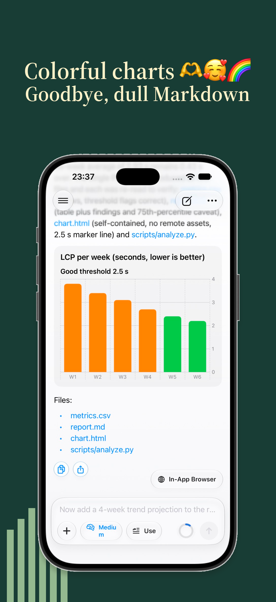

## Professional mode: an agent in a sandbox

Professional mode is an agent that runs on the device. Given a task, it breaks the work into steps and calls tools: it searches and reads web pages, extracts text from PDF, DOCX, and PPTX files, processes data and runs calculations in a built-in Python environment, and writes reports, tables, and charts to the workspace. The Python environment includes libraries for spreadsheets, symbolic math, and HTML parsing, and code and files stay in the workspace inside the app's sandbox. With system permission, it can also create calendar events, reminders, and contacts.

Larger tasks can be split into up to four subtasks that run at the same time. As a conversation grows, its context is compacted automatically, so long tasks can keep going. For research questions, Deep Research mode has the agent consult more sources before it reaches a conclusion.

Each workspace holds the conversations and files for one project, and output files can be browsed, previewed, and shared in the app. Every run is recorded step by step: the pages visited, files read, code executed, and time taken by each step can all be expanded. Tool approval has three levels: Ask Every Time, Auto Review (with review rules you can customize), and Allow All.

Workflows you rely on can be saved as skills. Skills use the SKILL.md format; you can import existing skill packages or have the agent write new ones.

  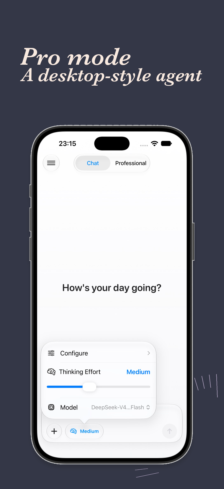
  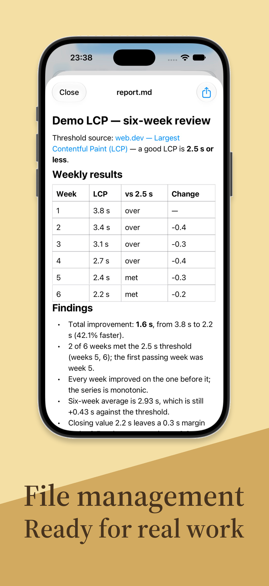
  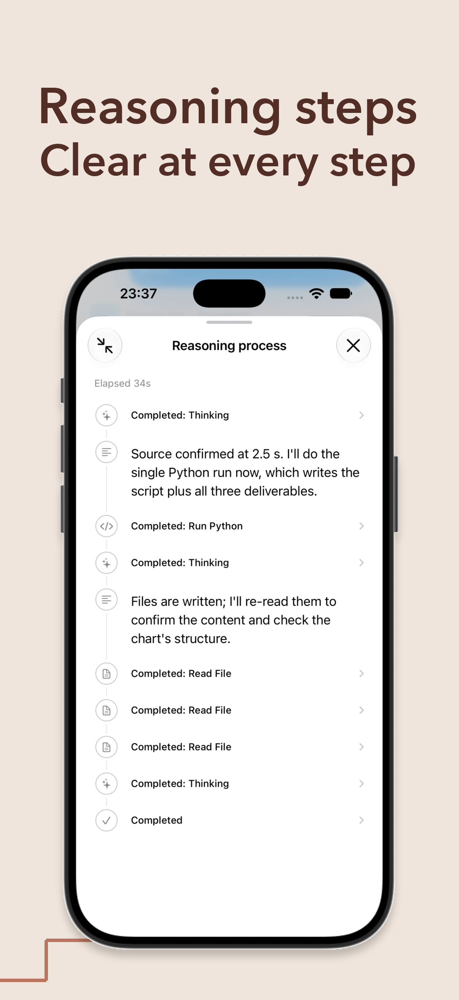

## Built-in browser

Professional mode includes a built-in browser. Tasks that have no API and can only be completed on a web page can be handed to the agent, which opens pages, clicks, types, and moves between tabs. When a page asks for a sign-in or human verification, you can take over and complete it yourself. Browser control is a beta feature.

  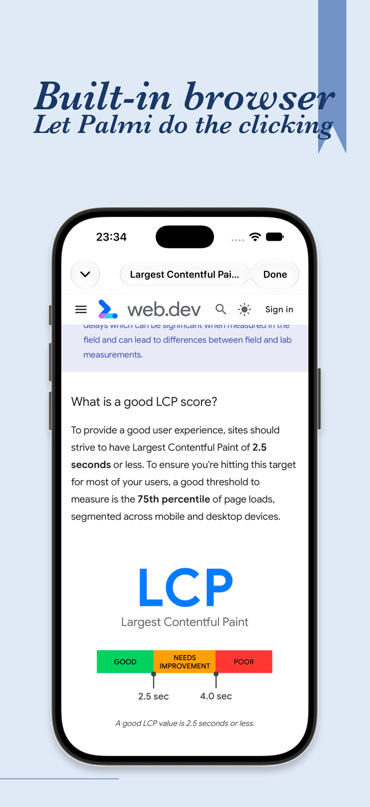

## Bionic mode

In Bionic mode, you define each character's name, avatar, personality, and background. Characters have long-term memory and remember past conversations. Replies can arrive instantly or at intervals closer to a real person's, and characters occasionally message you first. Palmi comes with a built-in character named Palmi; others can be created by hand, imported from an archive, or generated by the agent in Professional mode. Any character can be exported as a ZIP archive along with its chat history, memories, and avatar.

  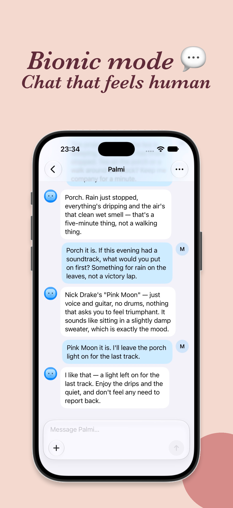

## Bring your own models

The model library organizes models by provider. OpenAI, Claude, Gemini, xAI, DeepSeek, Kimi, Zhipu AI, and Alibaba Cloud Bailian come preconfigured and are ready once you enter an API key. ChatGPT account holders can sign in through Codex and use the models their account includes. LM Studio and Ollama running on a computer can be connected over the local network. Any other service compatible with the OpenAI or Claude API format can be added by its endpoint URL.

Each conversation can use its own model and thinking level. Image understanding, web search, and page reading can each be assigned a separate model or service, using either a model's built-in web tools or standalone search APIs such as Kimi, Zhipu AI, and Baidu Qianfan.

  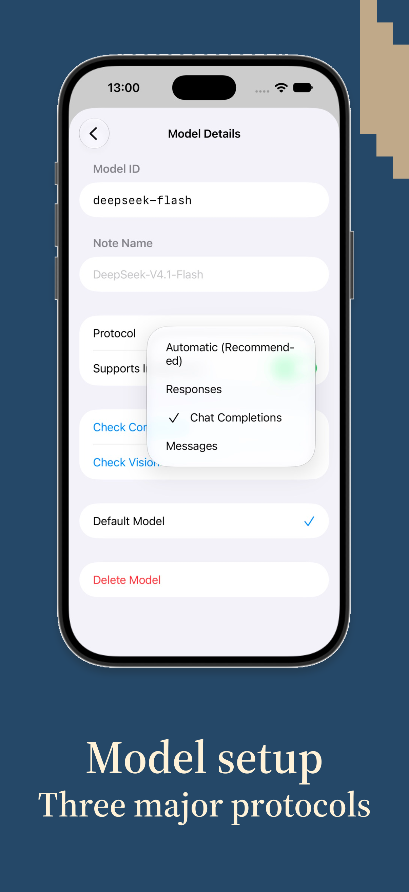

## iPad and larger screens

On iPad and other large screens, the browser, files, skills, and conversation list sit together in the sidebar, and web pages, charts, and file previews get more of the screen.

  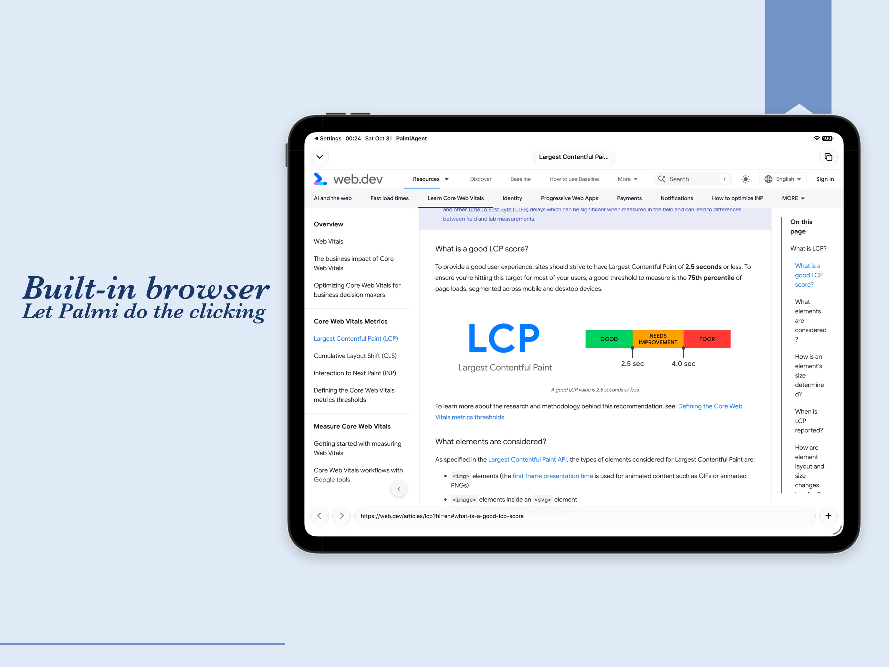
  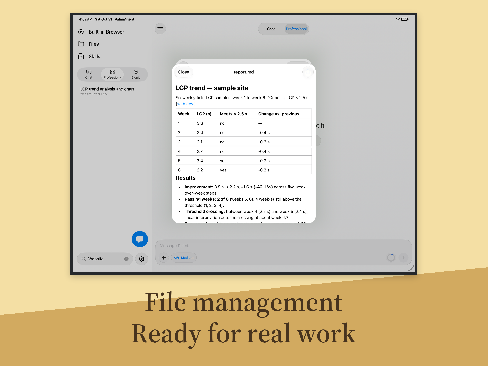

  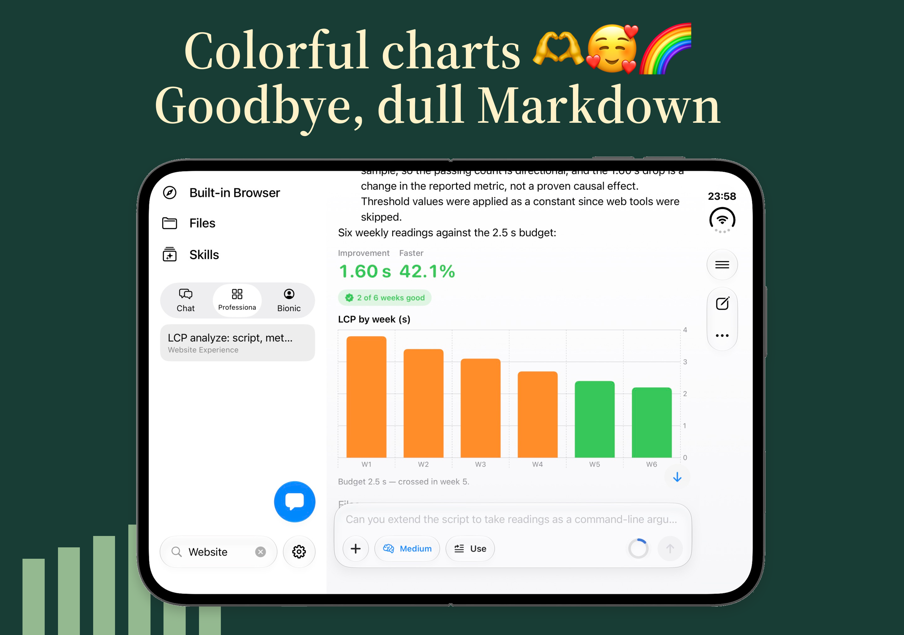
  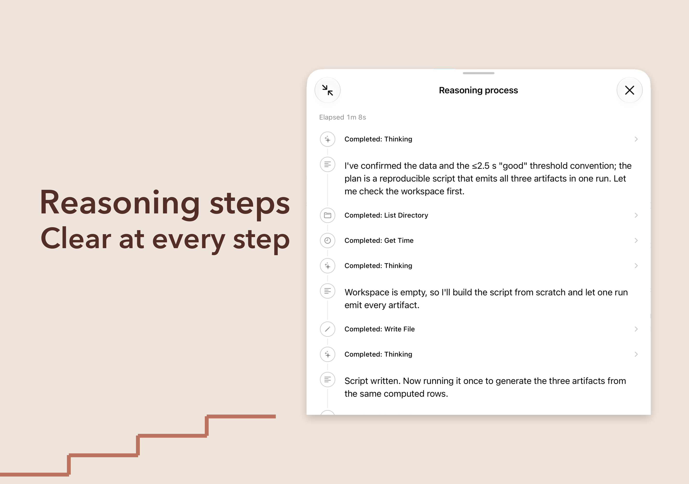

## Your data

Conversations, files, characters, and settings are stored on the device, and API keys are kept in the system Keychain. Palmi has no relay server: requests go directly from the device to the model service you chose, and that provider handles the data under its own terms and privacy policy. Access to Calendar, Reminders, Contacts, location, the camera, Photos, and the microphone requires system permission.

## Download

- Search for **Palmi** on the App Store, or open the [App Store page](https://apps.apple.com/us/app/palmiagent/id6787664658).
- Requires iOS or iPadOS 26.1 or later.
- Palmi is free to download. Model usage is billed by the provider you connect, and neither the app nor Bionic Pro includes model credits.
- Interface languages: English, Simplified Chinese, Traditional Chinese, Japanese, Korean, German, French, Swedish, Turkish, Indonesian, and Arabic.

## Links

- App Store: [United States](https://apps.apple.com/us/app/palmiagent/id6787664658) · [China mainland](https://apps.apple.com/cn/app/palmiagent/id6787664658)
- [Issues and feature requests](https://github.com/Hyp6666/PalmiAgent/issues)
- [Releases](https://github.com/Hyp6666/PalmiAgent/releases)
- [Contributing](CONTRIBUTING.md)
- [Third-party components and licenses](THIRD_PARTY_NOTICES.md)

## Open source

Palmi's source code is released under the [Apache License 2.0](LICENSE). The repository name, PalmiAgent, comes from the app's earlier name.
