

  <a href="README.md">English</a> · <strong>简体中文</strong>

  

<h1 align="center">Palmi</h1>

  iPhone 与 iPad 上的 AI 客户端。 
  接入自己的模型服务，用于日常对话、Agent 任务和虚拟角色。

  
  
  
  

  

Palmi 是一款 iPhone 与 iPad 上的 AI 客户端，本身不附带模型。OpenAI、Claude、Gemini、DeepSeek、Kimi、通义千问、智谱等服务均有预置配置，部署在自己电脑上的模型也可以经局域网接入。

## 三种模式

| 模式 | 用途 |
| --- | --- |
| 聊天 | 日常对话与写作。回复中可以嵌入原生图表、交互控件和 HTML 小应用。 |
| 专业 | 在设备沙盒中运行的 Agent，自行规划步骤并调用工具，执行过程逐步可查。 |
| 仿生 | 有名字、性格和长期记忆的虚拟角色，按自己的节奏回复，也会主动发来消息。 |

## 聊天：回复里的图表与小应用

遇到涉及数据或参数关系的问题，Palmi 会在回复中生成原生图表，并配上滑块、开关、计算器等控件，调整参数后图表随之更新。动画、模拟实验和小游戏以 HTML 小应用的形式嵌入回复，在对话中即可运行，比如一局 2048。

  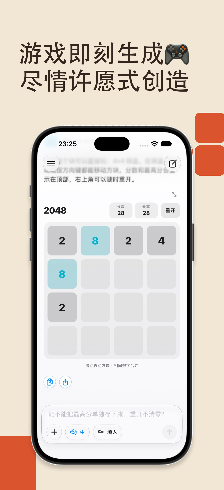
  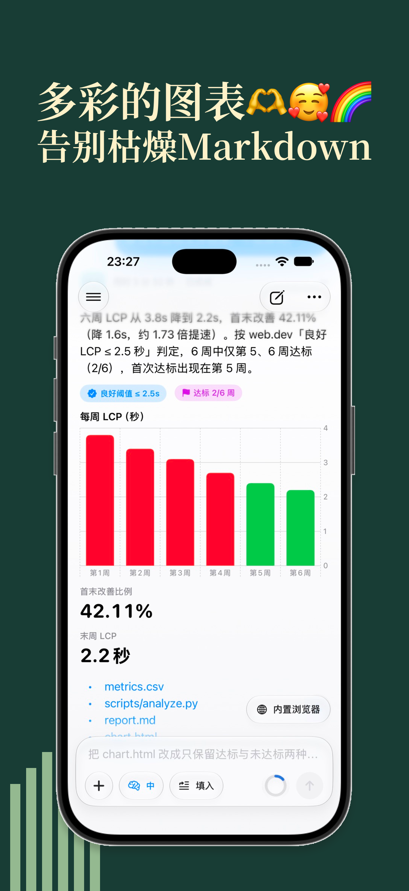

## 专业模式：在沙盒中运行的 Agent

专业模式是一个在设备上运行的 Agent。收到任务后，它会拆分步骤并调用工具：搜索和阅读网页，提取 PDF、DOCX、PPTX 中的文字，在内置的 Python 环境中处理数据和计算，再把报告、表格和图表写入工作区。内置的 Python 环境附带表格读写、符号运算和网页解析等常用库，代码与文件都留在 App 沙盒内的工作区里。获得系统授权后，它也能创建日历事件、提醒事项和联系人。

较大的任务可以拆成最多四个子任务同时进行；会话变长时，上下文会自动压缩，长任务不必中断。调研类问题可以切换到深度研究模式，Agent 会查阅更多来源，再给出结论。

每个工作区收纳一个项目的会话与文件，产出的文件可以在 App 内浏览、预览和分享。执行过程按步骤记录，访问过的网页、读取的文件、运行的代码以及各步耗时都可以展开查看。工具调用的审批分为三档：每次询问、自动审查（可自定义审核规则）和全部同意。

常用的工作流程可以保存为技能。技能采用 SKILL.md 格式，可以导入现成的技能包，也可以交给 Agent 编写。

  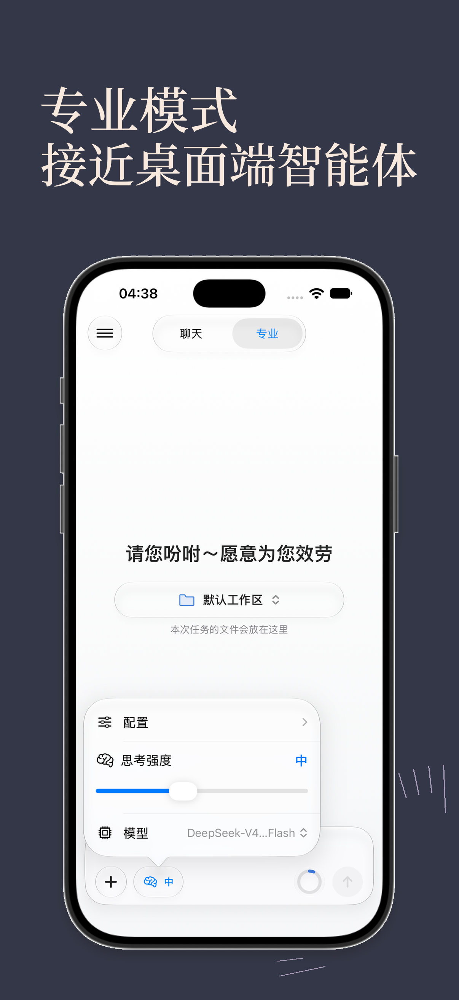
  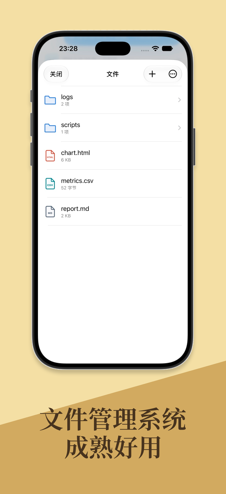
  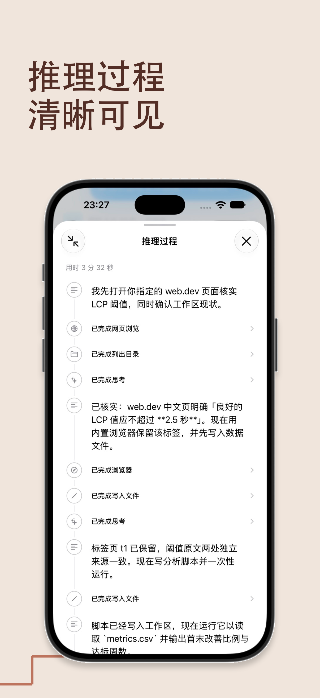

## 内置浏览器

专业模式带有一个内置浏览器。没有现成接口、只能在网页上完成的操作，可以交给 Agent 在浏览器中处理：打开页面、点击、输入，并在多个标签页之间切换。遇到登录或人机验证时，可以接管页面亲自操作。浏览器操控目前为测试功能。

  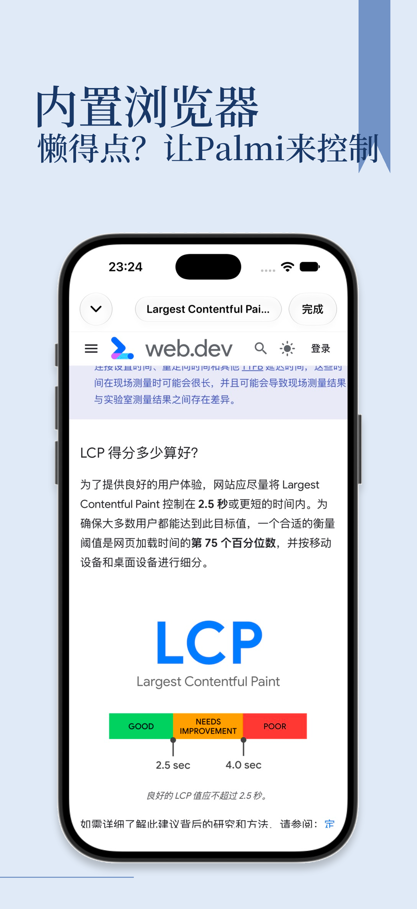

## 仿生模式

仿生模式中的角色由你设定名字、头像、性格与背景。角色拥有长期记忆，会记得过去聊过的内容；回复可以即时送达，也可以按接近真人的间隔发出，角色还会不定期主动发来消息。App 内置一个名为 Palmi 的角色，其他角色可以手动创建、从存档导入，或在专业模式中交给 Agent 生成。每个角色都可以连同聊天记录、记忆和头像一起导出为 ZIP 档案。

  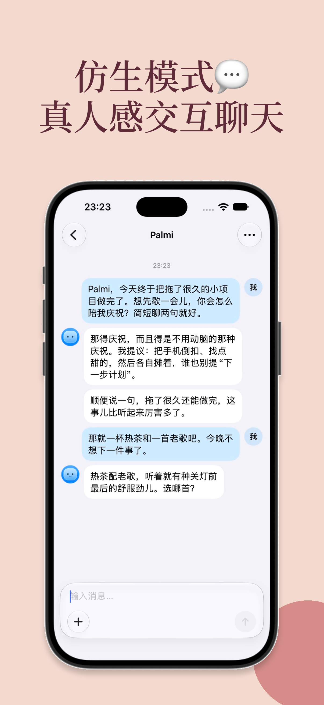

## 接入自己的模型

模型库按服务商组织模型。OpenAI、Claude、Gemini、xAI、DeepSeek、Kimi、智谱和阿里云百炼已有预置配置，填入 API Key 后即可使用。ChatGPT 账号可以通过 Codex 登录，使用账号内包含的模型；电脑上运行的 LM Studio 或 Ollama 可以经局域网连接。其他兼容 OpenAI 或 Claude 接口格式的服务，填写接口地址即可添加。

每个会话可以单独选择模型和思考强度。看图、网页搜索和网页读取也可以分别指定模型或服务，既能使用模型自带的联网能力，也能使用 Kimi、智谱、百度千帆等独立的搜索接口。

  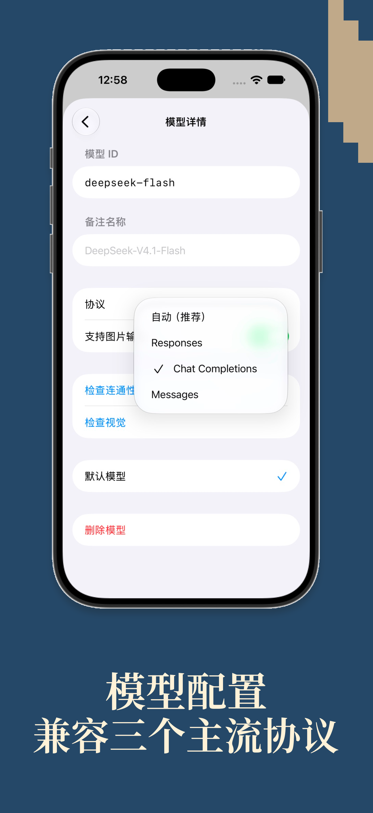

## iPad 与大屏设备

在 iPad 和其他大屏设备上，浏览器、文件、技能和会话列表集中在侧边栏，网页、图表与文件预览可以占用更多的屏幕空间。

  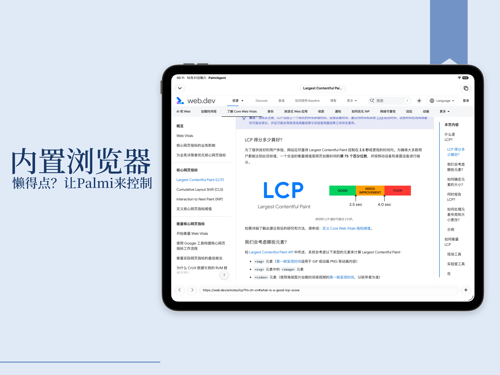
  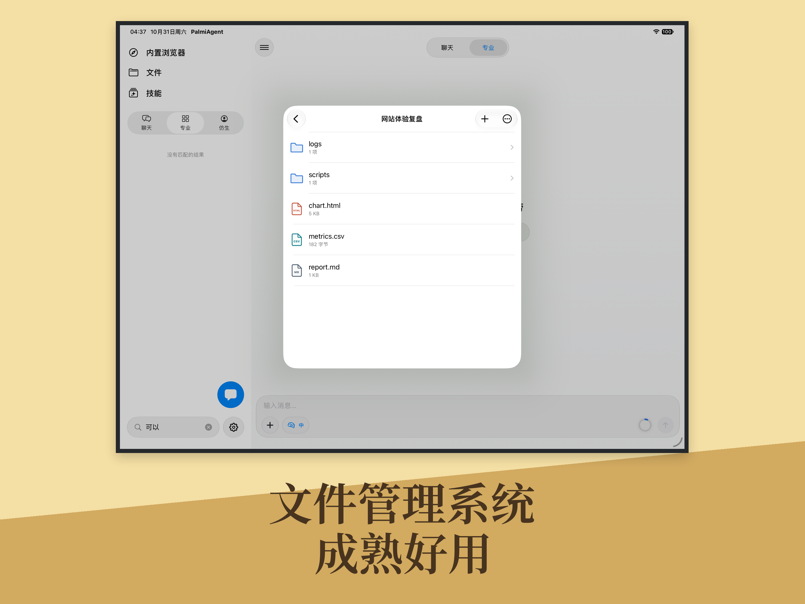

  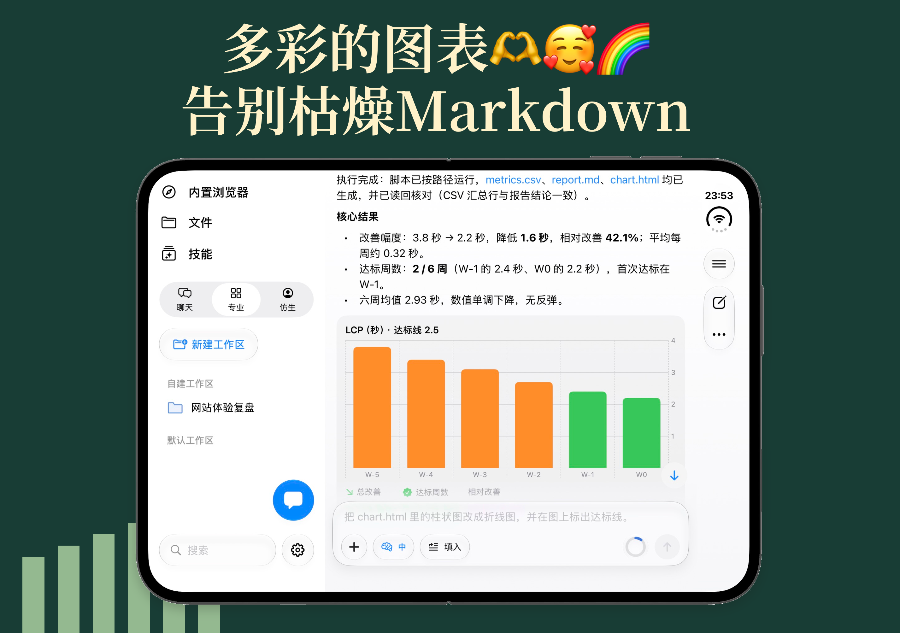
  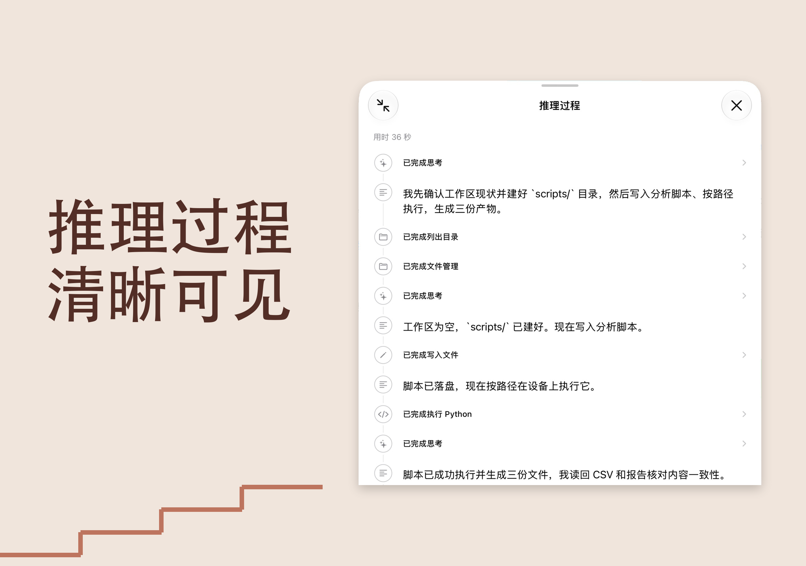

## 你的数据

会话、文件、角色和设置均保存在本机，API Key 存放在系统钥匙串中。Palmi 不设中转服务器，请求从设备直接发送到你所选的模型服务，相关数据由该服务商依照其条款和隐私政策处理。日历、提醒事项、通讯录、定位、相机、照片和麦克风的访问均需系统授权。

## 下载

- 在 App Store 搜索 **Palmi**，或打开 [App Store 页面](https://apps.apple.com/cn/app/palmiagent/id6787664658)。
- 需要 iOS 或 iPadOS 26.1 及以上版本。
- App 可免费下载。模型的调用费用由所接入的服务商收取，App 与仿生 Pro 均不包含模型额度。
- 界面语言：简体中文、繁体中文、英语、日语、韩语、德语、法语、瑞典语、土耳其语、印尼语、阿拉伯语。

## 链接

- App Store：[中国区](https://apps.apple.com/cn/app/palmiagent/id6787664658) · [美国区](https://apps.apple.com/us/app/palmiagent/id6787664658)
- [问题反馈与功能建议](https://github.com/Hyp6666/PalmiAgent/issues)
- [发布记录](https://github.com/Hyp6666/PalmiAgent/releases)
- [参与贡献](CONTRIBUTING.md)
- [第三方组件与许可证](THIRD_PARTY_NOTICES.md)

## 开源

Palmi 的源代码以 [Apache License 2.0](LICENSE) 发布。仓库名 PalmiAgent 沿用自 App 早期的名称。
